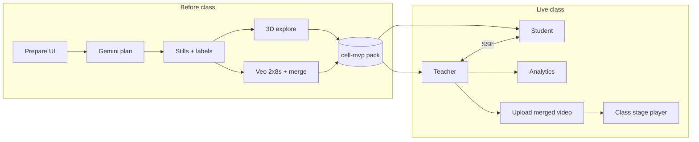

# CURIO — user journey & implementation plan

One place for **who does what in the product**, **what we built**, and **how it fits the original hackathon plan**. For deploy and GCP shape, see [architecture.md](architecture.md). For branch ownership during parallel work, see [plan.md](plan.md).

---

## Product in one sentence

A teacher leads a shared 3D lesson; students ask questions; the class explores together. Teachers **prepare** a topic pack (plan → stills → merged video → interactive 3D) on Google Cloud, then **teach** with analytics and optional upload of the full lesson video to the live stage.

---

## Routes & roles

| Route | Who | Purpose |
| --- | --- | --- |
| `/` (lobby) | Anyone | Open Teacher or Student |
| `/teacher` | Teacher | Live class: world, toolbar, questions, analytics, settings |
| `/student` | Student | Same lesson sync; ask questions; self-paced tabs including labeled diagrams |
| `/prepare` | Teacher | Generate or refresh the **cell-mvp** pack before class |

Default pack id: `cell-mvp` (`PREPARE_PACK_ID`). Generated assets live under `frontend/public/generated/cell-mvp/`.

---

## End-to-end user journey

### A. Before class — Prepare (teacher)

1. Teacher opens **Prepare**, enters **topic**, **age group**, **keywords**, and **language**.
2. Toggles (typical run):
   - **Gemini plan** — beats, 2 key objects, 4–8 diagram labels per object (factual pins for 3D/stills).
   - **Veo** — two ~8s clips from the same stills, then **merged lesson video** (~15s with crossfade).
   - **3D** — Google Cloud interactive explore.
3. Teacher clicks **Generate lesson pack**. Progress streams over SSE (`POST /api/prepare/assets?stream=1`).
4. UI fills in: stills with **2D labeled diagrams**, **3D explore** (rotate/zoom + pins), separate clips or **one merged player**, manifest status.
5. Pack is **frozen on disk** (`manifest.json` + per-object folders). Live class reads this pack; it does not re-call Veo during teaching.

**3D explore:**

- **Asteroid** — layered rotatable model; pins on core, mantle, crust, fractures, atmospheric entry, minerals (extinction science).
- **Dinosaur kingdom** — simple sauropod body; pins on brain, neck, heart/lungs, legs, tail, teeth (kid-friendly facts).
- Generic fallback for other topics until Gemini supplies rich labels on the next Prepare run.
- Pins scale with on-screen model size; zoom reveals more text; tap opens detail panel.

**Auth:** `GOOGLE_CLOUD_PROJECT` (or `gcloud config set project …`). Backend loads project via `env.js` / gcloud.

### B. Live class — Teacher

1. Teacher joins **Teacher** view; students join **Student** on the same room (SSE classroom state).
2. Teacher presents the **mountain** (or loaded lesson) world, uses toolbar: pause, explore beat, audio, captions, language (`en` / `hi` / `es`).
3. **Questions:** students submit text (or STT); teacher sees list, can **explore** a question → shared world changes; **return** restores lesson.
4. **Analytics** (full-screen focus): Overview, Live, Self-paced, **Merged lesson** (video language pie charts for `lesson-merged`), event stream; optional BigQuery when `BIGQUERY_DATASET` is set.
5. **Upload (toolbar):** picker shows **only the full merged lesson video** from the prepare pack — loads that clip on the class stage (not per-clip or raw 3D assets).
6. Optional **Settings:** Imagen diagram, Veo job start (background; not blocking live mountain loop).

### C. Live class — Student

1. Student opens **Student**; world stays in sync with teacher phase and beat.
2. Student asks questions; sees captions/narration in chosen language.
3. **Labeled diagram** tab: pick an object from the pack; **still** with zoom pins + **3D explore** with rotate/zoom and factual pins (same metadata as Prepare).

### D. After class (teacher / data)

- Analytics board summarizes curiosity (questions, modes, merged-video engagement).
- Events can stream to BigQuery (`sql/curiosity_events.sql`, `pack_id`, `item_id=lesson-merged` for merged video).
- Pack can be regenerated on Prepare; `reuseExisting` skips expensive steps when files already exist.

---

## Journey diagram (high level)



---

## Implementation map (what runs where)

### Prepare & assets

| Piece | Location | Role |
| --- | --- | --- |
| Prepare UI | `frontend/src/Prepare.jsx` | Form, SSE, pack cards, merged player |
| Asset viewers | `frontend/src/components/AssetViewer.jsx`, `LabeledDiagram.jsx` | Still diagrams or Google explore |
| 3D subject models | `frontend/src/explore/ExploreSubjectModels.jsx` | Asteroid / sauropod meshes |
| Label presets | `frontend/src/explore/exploreLabelPresets.js`, `backend/src/exploreLabels.js` | Engaging facts when manifest labels are generic |
| Scene scale / pins | `frontend/src/diagramSceneScale.js`, `diagramLabels.js` | Pin positions, zoom-adaptive HTML labels |
| Orchestration | `backend/src/prepareAssets.js` | Plan, stills, Veo, merge, mesh, `readCellPack()` |
| Google mesh | `backend/src/googleMesh.js` | Procedural mesh metadata for explore |
| Merge | `backend/src/mergeLessonVideo.js` | Single `lesson-merged` video |
| API | `backend/src/index.js` | `GET/POST /api/prepare/assets`, health |
| Safe JSON client | `frontend/src/safeJson.js` | Clear errors when API body empty (backend down) |

### Live classroom & analytics

| Piece | Location | Role |
| --- | --- | --- |
| Classroom SSE | `backend/src/classroom.js`, `frontend/src/useClassroom.js` | Phase, beats, questions |
| Teacher / Student | `frontend/src/Teacher.jsx`, `Student.jsx` | Live UI |
| Analytics | `frontend/src/components/AnalyticsPanel.jsx`, `backend/src/analyticsDigest.js` | Dashboard, merged-lesson video stats |
| Upload picker | `frontend/src/components/PrepareAssetPicker.jsx` | Merged video only |
| Stage player | `frontend/src/components/ClassLessonStage.jsx`, `LessonClipPlayer.jsx` | Merged clip + `lesson-merged` tracking |
| SQL | `sql/curiosity_events.sql`, `sql/curiosity_merged_lesson_queries.sql` | BQ schema & examples |

### Shared lesson (mountain prototype)

| Piece | Location | Role |
| --- | --- | --- |
| World / scenes | `frontend/src/World.jsx`, `scenes.jsx` | Default live 3D lesson |
| Lesson script | `backend/src/lesson.js` | Mountain beats |
| GCP | `backend/src/gcp.js` | Gemini, Imagen, Veo, TTS, BQ |

---

## Prepare pipeline (technical)

```
Teacher prompt
    → Gemini JSON (beats, objects, labels, exploreKind hint)
    → Imagen/Gemini still per object → source.png
    → Veo image→video per beat → video/clip-*.mp4
    → ffmpeg merge → merged lesson MP4 + captions in manifest
    → 3D: vertex explore mesh.json + UI procedural models
    → manifest.json + SSE events to Prepare UI
```

`GET /api/prepare/assets` enriches labels (`ensureExploreLabels`) and may rewrite `mesh.json` / manifest when recovering.

---

## Configuration (essentials)

| Variable | Purpose |
| --- | --- |
| `GOOGLE_CLOUD_PROJECT` | Vertex Gemini, Imagen, Veo |
| `PREPARE_PACK_ID` | Usually `cell-mvp` |
| `BIGQUERY_DATASET` | Analytics persistence |
| `CLASS_ROSTER_SIZE` | Live “active ratio” on analytics |

Local dev: `npm run dev` — API **8080**, Vite **5173+** (proxied to API).

---

## Original hackathon plan (parallel work)

From [plan.md](plan.md) — still valid for mountain live loop vs media slice:

| Owner | Focus | Key files |
| --- | --- | --- |
| **Raj** | Teacher chrome, toolbar, student–teacher sync | `SidePanel.jsx`, `Toolbar.jsx`, `Student.jsx`, `QuestionPanel.jsx` |
| **Anita** | Veo settings path, analytics board | `VideoSettings.jsx`, `AnalyticsPanel.jsx`, `gcp.js`, BQ SQL |

**Shared / avoid casual edits:** `Teacher.jsx`, `styles.css`, `classroom.js`, `World.jsx`, `lesson.js` unless integration requires a small change.

**Done when (original):**

- Teacher + student side by side with reliable question/explore/return sync.
- Veo can be started from teacher; curiosity events visible (and in BQ when configured).
- `npm run dev` and `./scripts/deploy.sh` still produce one Cloud Run service.

---

## Implementation status (this thread / pack-focused work)

| Capability | Status |
| --- | --- |
| Prepare: Gemini plan, stills, Veo, merge | Done |
| Merged lesson only on teacher upload picker | Done |
| Analytics: full-screen, merged video, BQ fields | Done |
| Labeled stills (zoom + pins) | Done |
| 3D explore: subject models + factual pins | Done |
| Label size synced to model zoom | Done |
| Auto label enrichment for dinosaur / asteroid packs | Done |
| Backend fix: duplicate `exploreLabels` import (crash → empty JSON) | Done |

**Not in scope / limits:**

- Google path is **educational 3D + labels**.
- Live class default world remains **mountain** unless teacher loads prepared merged video / explores questions.
- Classroom state is **in-memory** (single Cloud Run instance for demo).

---

## Suggested next steps

1. Re-run **Prepare** once with Gemini to refresh custom labels (4–8 parts) per object for new topics beyond dinosaur/asteroid presets.
2. Wire **teacher stage** to default-open latest pack merged video for topic-based demos (if product wants mountain + pack in one flow).
3. Merge Raj + Anita branches per [plan.md](plan.md); run two-browser demo script from README.
4. Deploy with `./scripts/deploy.sh` when integration is stable.

---

## Quick test script

1. `npm run dev` — confirm `curl -s http://127.0.0.1:8080/api/health` returns JSON.
2. **Prepare** — load pack; verify still + 3D explore on dinosaur and asteroid assets.
3. **Teacher** — Analytics → Merged lesson; Upload → only merged video.
4. **Student** — Labeled diagrams → rotate 3D, tap pins for facts.
5. Two browsers — ask question, teacher explores, return (mountain path).
